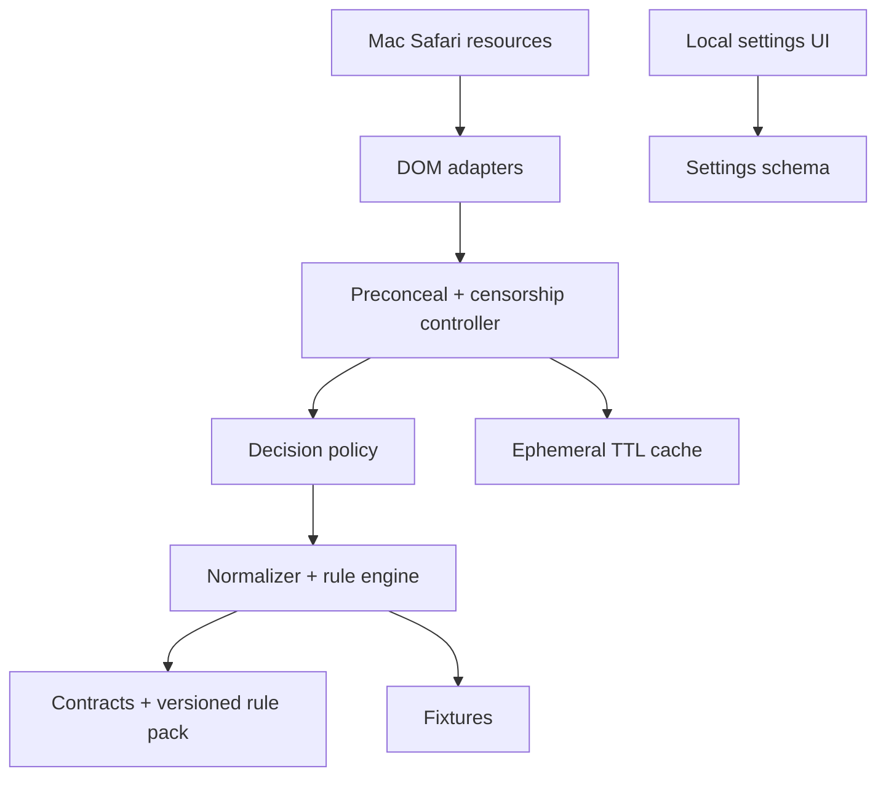

# Architecture review and decisions

The authoritative requirements are in `plan.md`. No changes to its scope are implied here.

## ADR 001: browser families, shared local runtime

Pure TypeScript packages serve all browser targets. Browser APIs and manifest differences stay at the platform boundary. backend/browser-targets.json drives installation routing and compatibility status; Chromium forks share one bundle, Firefox-compatible forks another, Safari its own manifest. New families need explicit API validation. Mobile projects and executable installers are archived at the user's request. Dependencies: adapters -> controller -> policy/rules/cache -> contracts; UI -> settings only.

## ADR 002: conceal before asynchronous work

Static document-start CSS conceals supported card selectors before script execution. A synchronous rules pass releases safe cards. Dynamic/recycled cards receive a synchronous mutation-observer guard before the next paint, including attribute and text changes. Each scan is bounded; undispatched cards remain guarded, not the entire page. A tiny independent startup script releases the initial guard after 5 seconds if the detector bundle fails; it has no dependencies, storage or network capability. The earlier CSS-animation-only fallback was removed after intermittent WebKit failures. Individually pending cards remain guarded. Unknown site layouts are explicitly uncovered; no selector system guarantees arbitrary site redesign coverage.

## ADR 003: ephemeral state and cache

An event-only background worker/page relays permission revocation to open content scripts; it has no detector, timers, state, storage writes or network API. Storage contains an allowlisted settings object and optional manually integrity-verified rules only. Results live in bounded memory under random element identifiers and never extend their creation TTL. Recycled DOM invalidates decisions. OFF, Clear Data, page lifecycle, site disable and storage preference changes clear results. Raw strings exist only during collection/classification; DOM remains owned by the website. No product diagnostics contain page content. Firefox receives a nonpersistent background script because its MV3 implementation does not support service workers; Chromium/Safari use the worker variant.

## ADR 004: opaque Blur and restoration

Clear Data uses an in-memory control message to open tabs; it writes no persistent signal token. Full reset leaves the extension storage empty. New preferences or rule assets are the only allowed persisted keys. Detached cards are restored immediately when removed, preventing a recycled item from retaining inert/opacity state while protection is OFF.

Blur includes an opaque accessible cover: CSS blur alone can leave readable shapes and cannot provide a safe guarantee. Hide collapses card children behind a compact placeholder. Both use a shadow-root reveal button and remove underlying cards from the accessibility tree while concealed. Restore original inline/accessibility attributes exactly. Pause an already-playing video when concealing, without reading frames or audio.

## ADR 005: image intelligence is capability gated

Ship rules-only as the measured baseline. Browser image-analysis contracts accept already-decoded static pixels, with one cancellable job and no URL-fetch capability. No OCR/model is enabled by default without representative incremental-value and low-end profiling evidence. Unsupported OCR is reported as unavailable, not silently substituted with remote inference.

## ADR 006: independent release gates

Unsigned development archives can be produced here. Store signing, browser-specific signing and low-end performance are external release gates. Synthetic browser fixtures do not establish real-site coverage, low-end hardware performance, representative precision/recall, or Apple/Google store approval.

## Feasibility sources (reviewed 2026-11-16)

- [Chrome content script lifecycle](https://developer.chrome.com/docs/extensions/develop/concepts/content-scripts): CSS precedes DOM construction; script uses document_start. Site content and other extensions can still change DOM later.

## Dependency graph

